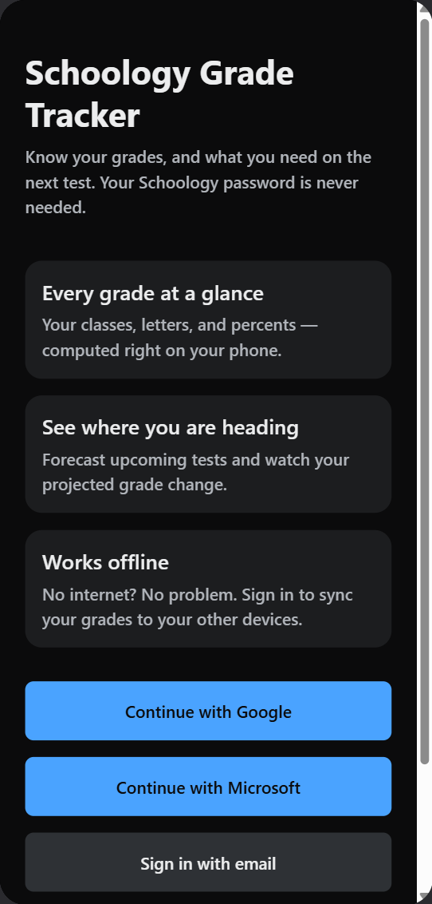
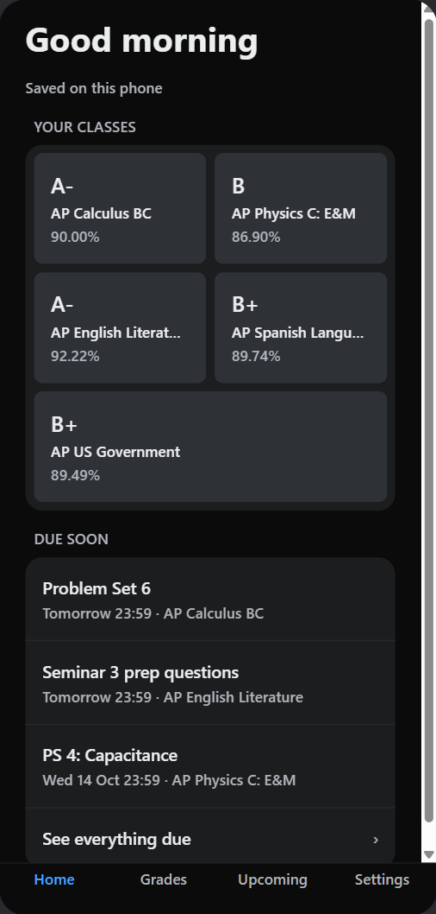
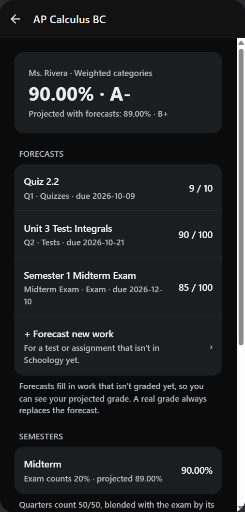

# Weekly status — week of Oct 5 – 9, 2026

Branch: [`claude/offline-sync-welcome`](https://github.com/KTaehong/SchoologyGradeTracker/tree/claude/offline-sync-welcome)
· Pull request: [#6](https://github.com/KTaehong/SchoologyGradeTracker/pull/6)
· Task tracker: [Trello board — Schoology Grade Tracker MVP](https://trello.com/b/rWqOVS5Y/schoology-grade-tracker-mvp-fall-2026)

## This week's tasks

| Task | Status |
|---|:--:|
| Welcome page and main landing page after login | ✅ Complete |
| Sign-in with Google | ✅ Complete |
| Sign-in with Apple | ⏸ Not planned (needs a paid Apple Developer account) |
| Offline grade engine, local storage and sync | ✅ Complete (two-phone test remaining) |

### 1. Welcome page and main landing page after login — Complete
- Added a welcome screen that appears the first time the app opens. The student
  can sign in with Google or email, or use the app without an account.
- Added a **Home** tab as the main landing page after login. It shows a personal
  greeting, the sync status, each class with its current letter grade and percent,
  the next three assignments due, and any classes with ungraded work that has no
  forecast yet.
- Moved the course list to its own **Grades** tab and connected the "Show welcome
  screen" option in Settings.

### 2. Additional sign-in methods
- **Google — Complete.** I created a Google Cloud project with an OAuth consent
  screen (testing mode, my account as the test user) and a web OAuth client that
  sends students back through Supabase. The Google provider is enabled in
  Supabase, and the app's redirect URLs (`gradetracker://auth/callback` and
  `exp://**` for Expo Go) are on Supabase's allow list.
- **Apple — Not planned.** It requires a paid Apple Developer account.

### 3. Offline grade engine, local storage and sync — Complete
- **Grade engine on the phone:** I ported the server's grade calculations to
  TypeScript, so grades are computed on the device. The results match the server
  exactly on all hand-checked test cases: weighted and points-based courses,
  excused and ungraded work, extra credit, dropping the lowest scores, semester
  exams and letter grades.
- **Local storage:** the full gradebook is stored in a SQLite database on the
  phone, so the app works completely offline.
- **Sync:** two new server functions exchange changes. One sends the phone's
  changes to the cloud; the other downloads changes made on other devices. Deletes
  are recorded so they reach every device.
- **Account handling:** on first sign-in, the student's existing courses are
  uploaded to their account. On sign-out, the app syncs one last time and then
  removes the account's data from the phone.
- **Live on Supabase:** the sync migration is applied to the live project, and its
  database test passed there with no test data left behind.
- **Remaining:** test sync between an iPhone and an Android phone (tracked on the board).

## Research items

| Topic | Outcome |
|---|---|
| SQLite for on-device storage | **Implemented** with expo-sqlite. |
| Refresh logic | **Implemented.** The app syncs on launch, when it returns to the foreground, when the connection returns, shortly after each edit, and on pull-to-refresh. |
| Connectivity detection | **Implemented** with NetInfo. Changes made offline are queued and sent automatically when the connection returns. |
| Checking the backend for updates | **Implemented.** The app asks the server only for changes since its last sync, so it never downloads the whole gradebook again. |
| Notifying other devices of changes | **Partially implemented.** Supabase Realtime makes other devices refresh within seconds while the app is open. True push notifications to a closed app are deferred: they need custom iOS and Android builds (APNs and Firebase Cloud Messaging), and the app catches up on its next launch anyway. |
| ETags | Supabase's API does not support ETags, so I **implemented an equivalent**: each change gets a revision number per student, and an empty reply from the server means nothing has changed (like an HTTP 304). Only changed records are sent. |

Design write-up: [`docs/sync.md`](../sync.md).

## Testing / evidence
- **App tests:** 111 / 111 pass (up from 79), typecheck and lint clean — see
  [`test-run.txt`](2026-10-09/test-run.txt).
- **Database tests:** `gradebook_test.sql`, `grade_api_test.sql` and the new
  `sync_test.sql` pass locally (PGlite) and on the live Supabase project.
- **Grade engine:** matches the server's hand-checked numbers on the sample
  gradebook (e.g. AP Calculus BC current 90.00% A-, projected 89.00% B+).

| Welcome screen | Home (landing page) | Course detail with forecasts |
|---|---|---|
|  |  |  |

*Screenshots are from the app's web build at phone width.*

**Airplane mode:** _to add — phone screenshots (iPhone and Android) of the Grades
tab with airplane mode on, showing the same grades._

## Issues / blockers
- **Two-phone sync test** not done yet.
- **PR #6** is open and not merged yet.

## New tasks for this week (Oct 12 – 18)
1. Merge PR #6.
2. Test on an iPhone and an Android phone (Expo Go): Welcome, Home, Google sign-in,
   grades in airplane mode.
3. Test sync between an iPhone and an Android phone (edit on one, see it on the
   other; offline edits sync on reconnect).
4. T2.1 Manual entry: add a class (name, teacher, weighted or points grading).
5. T2.1 Manual entry: add, edit and delete categories with weights and drop-lowest.
6. T2.1 Manual entry: add, edit and delete assignments (score, points possible,
   excused, extra credit).
7. Edit and delete a whole course; changes recompute grades and sync.
8. Set up EAS Build and make the first Android development build (iPhone testing
   stays in Expo Go).
